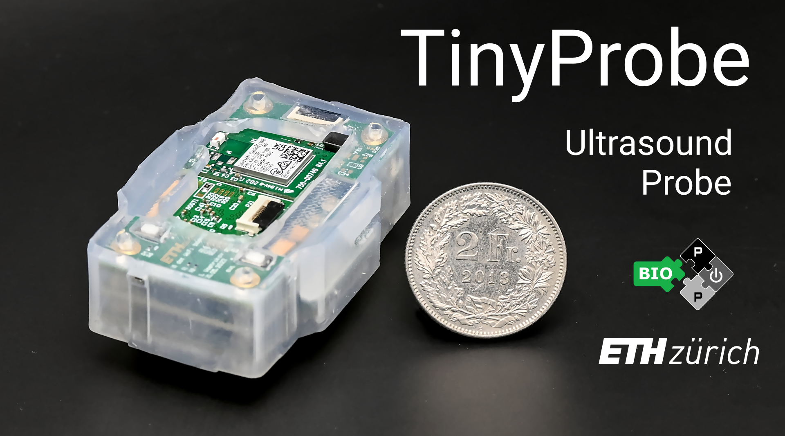
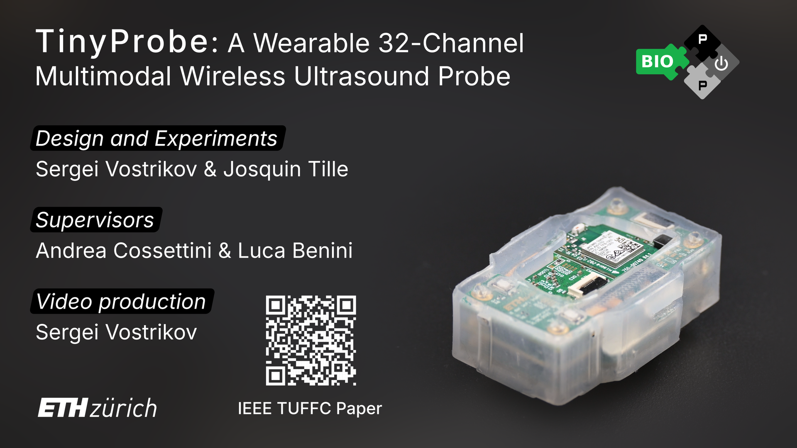
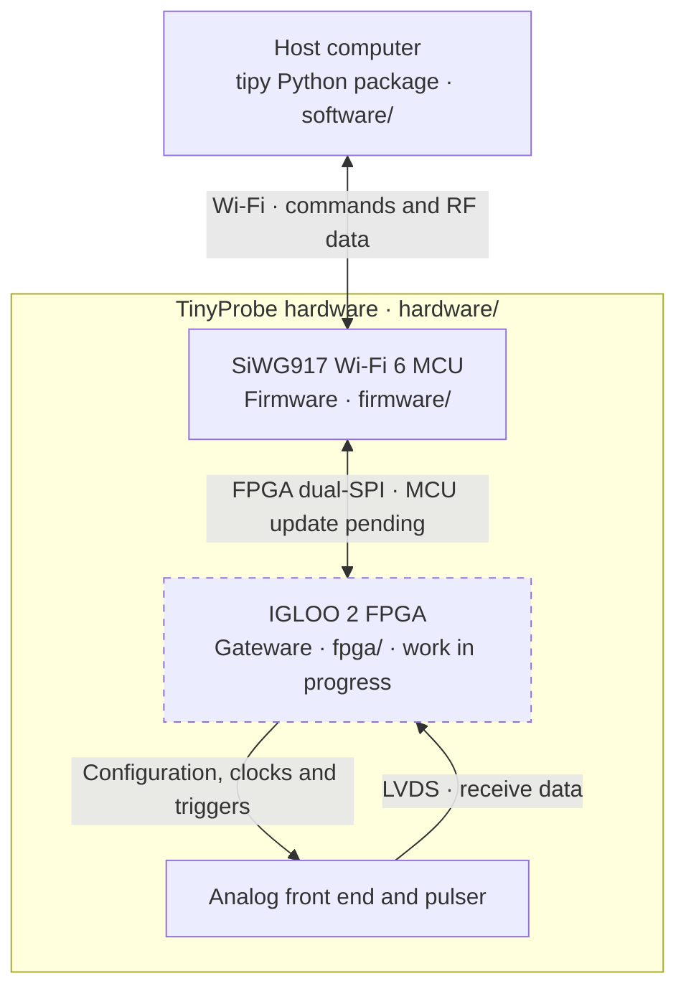

# TinyProbe

A Wearable 32-Channel Multi-Modal Wireless Ultrasound Probe

> **Work in progress.** This branch is work in progress to update tinyprobe bandwidth.

> **Implemented.** Single spi (from hte original paper) is replaced by dual spi. **Warning:** Using the dual SPI implementation with the SiW917 has a limited bandwidth due to SiWG917’s dual-SPI 10MHz limit.
> **Work in progress.** We are upgrading the PCBs and system controller to overcome this dual-SPI limitation. 
> **Work in progress: `feature/dual-spi`.** This branch includes FPGA gateware, but the included SiWG917 MCU firmware is currently incompatible with its dual-SPI protocol. Assembling the hardware and programming this branch as-is will **not produce a working acquisition system**. The updated SSI-based dual SPI interface will fix this incompatibility.

## Introduction

This repository contains ongoing work on **TinyProbe**, an advanced wearable ultrasound platform developed at the [Integrated Systems Laboratory (IIS)](https://iis.ee.ethz.ch/) of ETH Zurich.

## FPGA release status (work in progress)

This branch publishes FPGA RTL, pin and timing constraints, simulation tests, and a source-based Hog/Libero build. Compared with the single-SPI readout in the original TinyProbe paper, it introduces dual-SPI payload transfers to increase the FPGA-side readout bandwidth. Updating the SiWG917 MCU firmware to support this interface is planned and is not included in this release.

| Interface | Raw rate | Status |
| --- | --- | --- |
| FPGA dual-SPI payload | At most **20 Mbps** (two bits per clock) | Requires a compatible MCU driver |
| Included MCU single-SPI driver | At most **40 Mbps** (one bit per clock) | Uses the legacy protocol; incompatible with this gateware |

The reduced bandwith with the dual spi interface is due to a limitation of the current SiWG917 MCU, which is only able to run dual and quad SPI at 1/4 of the speed of single SPI.

See the [FPGA status and build instructions](fpga/Readme.md).

## Published-system capabilities

The specifications and frame rates below describe the published TinyProbe configurations; they are not measurements of this development branch.

### Transmit

- **64 V peak-to-peak** bipolar excitations
- **32 pattern profiles** (fully programmable)
- **16 delay profiles** (fully programmable)

### Receive

- **21, 18, or 15 dB** low-noise amplifier (programmable)
- **21, 24, or 27 dB** programmable gain amplifier (PGA)
- **Up to 36 dB TGC** (fully programmable)
- **32 channels** (simultaneously sampled at up to **30 MSps, 10 bit**)

### Connectivity

Wi-Fi 6 link, data rates up to **35.7 Mbps**

### Operating Modes

1. **A-mode**, **B-mode**, **M-mode** with 32 channels (**175 FPS with Wi-Fi 6**, 32 channels, 400 samples per channel)
2. **Doppler mode** with 2 channels (**1500 FPS**)
3. **Raw RF data streaming** (**55 FPS**, 32 channels, 2000 samples per channel, 10 bit per sample)

The system design is described in detail in our publications in the [IEEE Transactions on Ultrasonics, Ferroelectrics, and Frequency Control (TUFFC)](https://ieeexplore.ieee.org/document/10750870), and in the [Proceedings of the IEEE International Ultrasonics Symposium (IUS 2025)](https://ieeexplore.ieee.org/abstract/document/11201780).

Please also take a look at our overview video on YouTube:

<a href="https://www.youtube.com/watch?v=qGP9-kKss0g">
  
</a>


## Contents

Host software, MCU firmware, board hardware, and FPGA gateware are in this repository. FPGA/MCU integration on this branch is work in progress.



See the [hardware overview](hardware/README.md) for individual boards and their interconnections.

```bash
.
├── software/               # Host Python package, demos, and tests
├── firmware/               # SiWG917 Wi-Fi 6 MCU firmware
├── fpga/                   # FPGA RTL, constraints, tests, and Hog build (WiP)
├── hardware/               # Board PCB designs
│   ├── wifi_board/         # Wi-Fi 6 PCB
│   ├── hv_board/           # Pulser PCB
│   └── acquisition_board/  # Acquisition board and its power-fix board
├── container/              # Docker and Apptainer firmware toolchain
├── config/                 # Description files for methods and register maps
├── docs/                   # Documentation files (Markdown, images, mkdocs)
└── licenses/               # Hardware, software, and image licenses
```


## Development

This repository uses [`uv`](https://docs.astral.sh/uv/) and [`just`](https://github.com/casey/just) for Python dependency and tool management. `just` is also included in the Python environment for convenience.

You can run `just` from the project root to see all available targets:

```bash
uv run just # Without activating Python environment
just # After activating Python environment / Using native binary
```

There is a [root workspace](pyproject.toml) at the project root as well as a [host project](software/pyproject.toml) project in the software directory.

The root workspace installs the host project in editable mode, so host development commands can also be run from the repository root.


### Dependency groups

You may not always need all of the dependencies, which is why there are multiple [dependency groups](https://docs.astral.sh/uv/concepts/projects/dependencies/#dependency-groups) with their own set of packages.


#### Root Workspace

| Group | Purpose |
| --- | --- |
| base | `just` and the host project |
| `dev` | Code generation and pre-commit hooks ([`embgen`](https://github.com/CedricHirschi/embgen), [Protocol Buffers](https://protobuf.dev/), [`prek`](https://prek.j178.dev/)) |
| `doc` | Documentation generation and serving ([Material for MkDocs](https://squidfunk.github.io/mkdocs-material/)) |

To install all of dependencies, run:

```bash
uv sync --group dev --group doc
```

#### Host Project

| Group | Purpose |
| --- | --- |
| base | Core dependencies for all functionalities |
| `dev` | Tests, linting, and type checking ([`pytest`](https://docs.pytest.org/en/stable/), [`ruff`](https://docs.astral.sh/ruff/), [`ty`](https://docs.astral.sh/ty/)) |
| `demo` | Demonstration and visualization ([`matplotlib`](https://matplotlib.org/)) |


To install all of dependencies, run:

```bash
cd software
uv sync --group dev --group demo
```


## Documentation

The MkDocs documentation in `docs/` starts with a system overview, followed by host software and Wi-Fi 6 firmware references. New contributors should begin with the system overview to understand how the host, MCU, FPGA, AFE, and TX paths fit together. Build or serve the site locally from the repository root:

```bash
just docs_serve
```


## Citation

If you would like to reference the TinyProbe project, please cite:

```
@article{vostrikov2024tinyprobe,
  title={TinyProbe: A wearable 32-channel multi-modal wireless ultrasound probe},
  author={Vostrikov, Sergei and Tille, Josquin and Benini, Luca and Cossettini, Andrea},
  journal={IEEE Transactions on Ultrasonics, Ferroelectrics, and Frequency Control},
  year={2024},
  publisher={IEEE}
}
```

If you would like to reference only the Wi-Fi 6 PCB design, please cite:

```
@inproceedings{hirschi2025high,
  title={High Frame Rate Arterial Monitoring via Wi-Fi 6 on a 32-channel Wearable Ultrasound Probe},
  author={Hirschi, Cédric and Vostrikov, Sergei and Cossettini, Andrea and Benini, Luca},
  booktitle={2025 IEEE International Ultrasonics Symposium (IUS)},
  pages={1--4},
  year={2025},
  organization={IEEE}
}
```


## Authors

The TinyProbe system was developed at the [Integrated Systems Laboratory (IIS)](https://iis.ee.ethz.ch/) at ETH Zurich by:

- [Sergei Vostrikov](https://scholar.google.com/citations?user=a0KNUooAAAAJ) (Full-stack TinyProbe design)
- [Cédric Hirschi](https://scholar.google.com/citations?user=GRiRvUQAAAAJ) (Wi-Fi 6 Hardware development, Firmware & Software development)
- [Federico Villani](https://scholar.google.com/citations?user=5LgLMCEAAAAJ) (Hardware development)
- [Andrea Cossettini](https://scholar.google.com/citations?user=d8O91jIAAAAJ) (Supervision, project administration)
- [Luca Benini](https://scholar.google.com/citations?hl=en&user=8riq3sYAAAAJ) (Supervision, project administration)

Thanks to all the people who contributed to the TinyProbe platform:

- [Josquin Tille](https://scholar.google.com/citations?user=fLvAndoAAAAJ) (Silicone Package, Adapter PCB design)
- [Soumyo Bhattacharjee](https://scholar.google.com/citations?user=m5mJcRIAAAAJ) (Gateware, Firmware QSPI development)


## License

This repository makes use of the following licenses:

- for all *hardware* (`hardware/` and `fpga/`): [Solderpad Hardware License Version 0.51](licenses/LICENSE.hw)
- for all *software* (`software/`): [Apache License Version 2.0](licenses/LICENSE.sw)
- for all *images* (`docs/images/`): [Creative Commons Attribution 4.0 International License](licenses/LICENSE.images)

For further information, please refer to the license files: `licenses/LICENSE.hw`, `licenses/LICENSE.sw`, `licenses/LICENSE.images`.

The `firmware/`, `software/`, and `fpga/` directories contain third-party sources with their own licenses. See the [firmware](firmware/README.md) [software](software/README.md), and [FPGA](fpga/Readme.md#license) READMEs.
